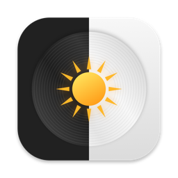
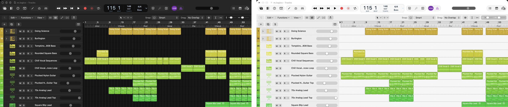
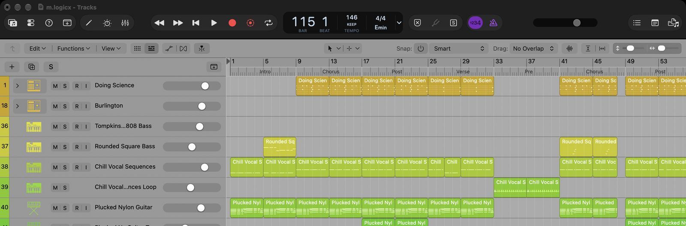

<p align="center">
  
</p>

<h1 align="center">BrightMeUp</h1>

<p align="center">
  A bright look for Logic Pro.<br>
  Turn the dark interface light, pick from 31 presets, and set each part of Logic Pro your way.
</p>

<p align="center">
  <a href="https://github.com/adigold/BrightMeUp/releases/latest/download/BrightMeUp.dmg"></a><br>
  For Logic Pro 13 on Macs with Apple silicon.<br>
  <b>Tested only with Logic Pro 13. Earlier versions, such as Logic Pro 12, are not supported.</b>
</p>

<p align="center">
  Powered by <a href="https://inplug.app">InPlug.app</a>
</p>

<p align="center">
  
</p>

<p align="center">
  
  <br><i>Left: Logic Pro as it ships. Right: the same project with BrightMeUp.</i>
</p>

## Made for long sessions

Logic Pro comes only in dark. In a bright studio, or after hours of mixing, a dark screen can tire your eyes. BrightMeUp opens Logic Pro in a light look, from crisp white to a calm gray, and you decide how far to go.

- **31 ready looks** in six groups: Bright, Balanced, Dim, High contrast, Low contrast and By area.
- **Every area on its own.** Tracks, Mixer, Editors, Control bar, Inspector, Browsers and shared panels can each follow your look, get their own values, or stay in the original dark.
- **Your plug-ins look like always.** Every plug-in window, from Apple or any other maker, keeps its own design.
- **See it first.** A live preview shows the Main window, Tracks, Mixer, Piano Roll and plug-ins, with a Before and After switch.
- **Save and share.** Save your favorite looks, export them as a file, and load looks that other people send you.
- **Updates in one click.** When a new version is out, BrightMeUp tells you and installs it for you.
- **Nothing to undo.** Your projects and the Logic Pro app stay exactly as they are.

## Get started

1. **[Download BrightMeUp](https://github.com/adigold/BrightMeUp/releases/latest/download/BrightMeUp.dmg)** and open `BrightMeUp.dmg`.
2. Drag BrightMeUp to Applications, then open it. It is signed and notarized by Apple, so it opens with no warning.
3. Pick a look in the sidebar.
4. Click **Start Logic Pro**. If Logic Pro is already open, click **Restart Logic Pro**, and Logic Pro asks you to save first.

You need Logic Pro 13.0, a Mac with Apple silicon, and macOS 26. A zip version of every release is on the [Releases page](https://github.com/adigold/BrightMeUp/releases).

## Make it yours


**Lightness** sets how light the backgrounds are. At 100% they are white, and lower values give a softer gray.

**Middle grays** sets how much the buttons, lines and controls stand out. Move it up for more contrast.

In the **Areas** tab, give one part of Logic Pro its own look, or keep it in the original dark. Track and region colors always stay as they are.

Press **Command S** to save the current look as a preset, and **Command 0** to go back to the default Light look.

### Share a look

Click **Share** next to Save as Preset:

- **Export Current Look...** saves your look as a small file you can send to anyone.
- **Load Preset...** opens a look someone sent you and adds it to My presets.

To export one of your saved presets, right-click it in the sidebar.

## A dark control bar

Like the transport and display in dark? Pick the **Dark Control Bar** preset, or set Control bar to Original in the Areas tab. The rest of Logic Pro stays light.



## Going back to dark

Click **Revert to Logic Defaults** at the top right of BrightMeUp. Logic Pro restarts in its original dark look, and your BrightMeUp settings stay saved for next time.

Opening Logic Pro from the Dock always gives you the original look too.

## When Logic Pro updates

Each BrightMeUp version is tested with one Logic Pro version. If yours is different, BrightMeUp shows a note, and a few parts of Logic Pro may stay dark until a matching BrightMeUp version is out.

## Uninstall

Move BrightMeUp from Applications to the Trash. To also clear its settings, run this in Terminal:

```sh
defaults delete com.adigoldstein.brightmeup
rm -r ~/Library/Caches/com.adigoldstein.brightmeup
```

## For developers

With Xcode installed:

```sh
git clone https://github.com/adigold/BrightMeUp.git
cd BrightMeUp
app/build.sh
```

The app is built at `app/BrightMeUp.app`. Set `SIGN_ID` to your own Developer ID certificate to sign it for other Macs.

## About

BrightMeUp builds on [I See Logic Pro](https://github.com/karlingen/i-see-logic-pro) by Karl Metum, an open source project under the MIT license. Thank you, Karl.

BrightMeUp is not made by Apple, and Apple does not support it. Logic Pro is a trademark of Apple Inc. See [LICENSE](LICENSE) for the license.

© 2026 InPlug/AGsoundtrax LLC, All rights reserved.
