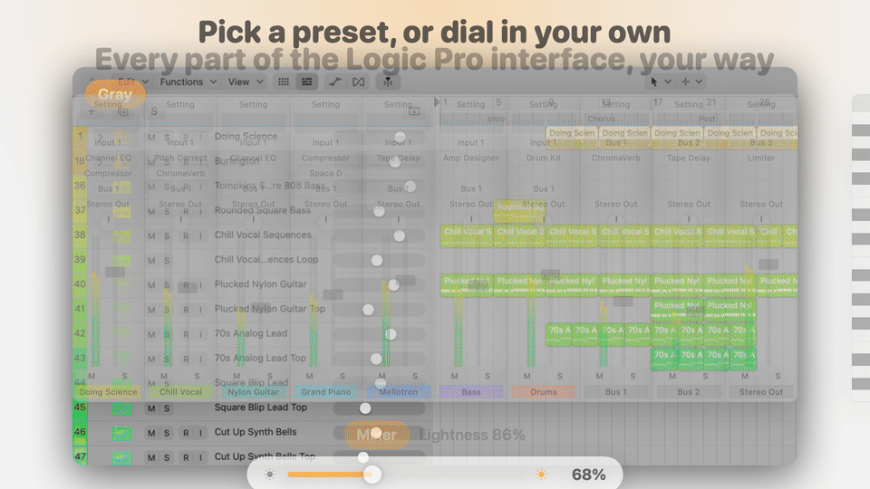
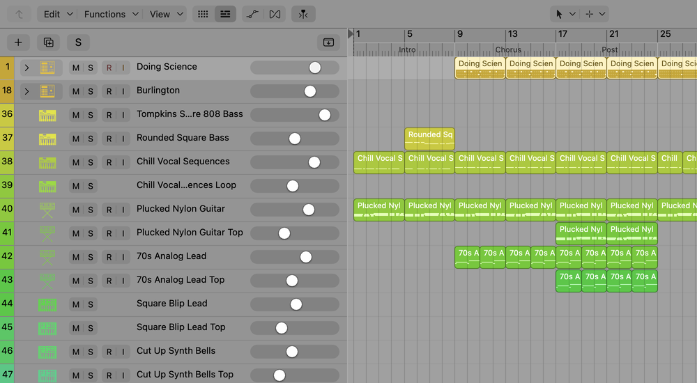
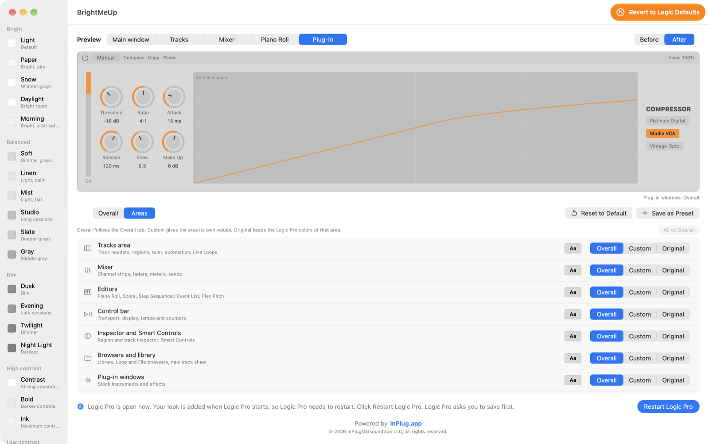

<p align="center">
  
</p>

<h1 align="center">BrightMeUp</h1>

<p align="center">
  A bright look for Logic Pro.<br>
  Turn the dark interface light, pick from 30 presets, and set each part of Logic Pro your way.
</p>


<p align="center">
  Powered by <a href="https://inplug.app">InPlug.app</a>
</p>

<p align="center">
  
</p>

## Why you want it

Logic Pro only comes in dark. That is great at night, but in a bright room or on a long day the dark screen can be hard on your eyes. BrightMeUp gives Logic Pro a light look, as bright or as soft as you like.

- **30 presets** in six groups: Bright, Balanced, Dim, High contrast, Low contrast and By area.
- **Every part your way.** Set the Tracks area, Mixer, Editors, Control bar, Inspector, Browsers and shared panels on their own, or keep any of them in the original dark look.
- **Plug-ins stay untouched.** BrightMeUp changes only the Logic Pro interface. Every plug-in window, built in or third party, keeps its own look.
- **Live preview.** See the Main window, Tracks, Mixer or Piano Roll change while you move the sliders, and compare Before and After.
- **Your own presets.** Save your favorite settings and switch in one click.
- **Back to stock in one click.** Revert to Logic Defaults restarts Logic Pro in its original look. Your settings stay saved for next time.
- **Nothing to undo.** BrightMeUp never changes Logic Pro or your projects. Open Logic Pro from the Dock and it looks exactly like it always did.

| Stock Logic Pro | Light |
| --- | --- |
|  |  |
| **Soft** | **Gray** |
|  |  |

## Download and install

**[Download BrightMeUp for Mac](https://github.com/adigold/BrightMeUp/releases/latest/download/BrightMeUp.dmg)**

1. Click the link above. Your browser downloads `BrightMeUp.dmg`.
2. Double-click `BrightMeUp.dmg`. A window opens.
3. Drag `BrightMeUp` onto the Applications folder in that window.
4. Open BrightMeUp from your Applications folder.

BrightMeUp is signed and notarized by Apple, so it opens with no warning.

All versions are on the [Releases page](https://github.com/adigold/BrightMeUp/releases). Each release also has a `BrightMeUp.zip` if you prefer a zip file.

### Requirements

- Logic Pro 13.0
- A Mac with Apple silicon
- macOS 26

## How to use it



1. Open BrightMeUp.
2. Pick a preset in the sidebar, or move the Lightness and Middle grays sliders.
3. Want one part different? Open the **Areas** tab and set that part to Custom or Original.
4. Click **Start Logic Pro**. If Logic Pro is already open, click **Restart Logic Pro**. Logic Pro asks you to save first.

Your look is added when Logic Pro starts, so a change shows the next time Logic Pro opens.

### The two sliders

| Slider | What it does |
| --- | --- |
| Lightness | How light the backgrounds are. 100% is white, lower is a softer gray. |
| Middle grays | How dark the buttons, lines and controls are against the background. Higher gives more contrast. |

Track and region colors always keep their own colors.

### Handy shortcuts

| Shortcut | Action |
| --- | --- |
| Command S | Save the current look as a preset |
| Command 0 | Reset to Default (the Light preset) |

## Go back to the original look

Click **Revert to Logic Defaults** at the top right of BrightMeUp. It asks you to confirm, then restarts Logic Pro in its original dark look. Your BrightMeUp settings stay saved, so you can come back any time with Start Logic Pro.

You can also simply open Logic Pro from the Dock. It always opens in its original look.

## After a Logic Pro update

Each version of BrightMeUp is tested with one version of Logic Pro. If you have a different version, BrightMeUp tells you, and a few parts of Logic Pro may stay dark. Check the [Releases page](https://github.com/adigold/BrightMeUp/releases) for a newer version.

## Remove

1. Delete `BrightMeUp` from your Applications folder.
2. Optional: delete the saved settings. Run this in Terminal:

   ```sh
   defaults delete com.adigoldstein.brightmeup
   rm -r ~/Library/Caches/com.adigoldstein.brightmeup
   ```

## Build from source

You need Xcode.

```sh
git clone https://github.com/adigold/BrightMeUp.git
cd BrightMeUp
app/build.sh
```

The app appears at `app/BrightMeUp.app`. To sign it for other Macs, set `SIGN_ID` to your own Developer ID certificate before you build.

## About

BrightMeUp is not made by Apple, and Apple does not support it. Logic Pro is a trademark of Apple Inc.

© 2026 InPlug/AGsoundtrax LLC, All rights reserved.
